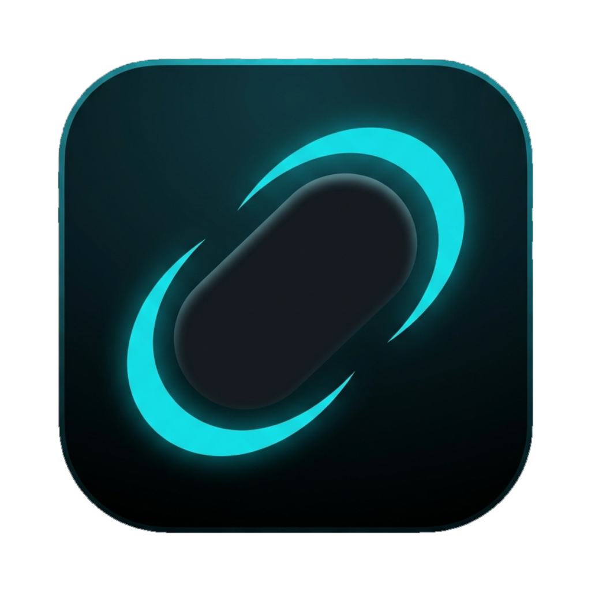

<div align="center">



# Orbit

**Una isla dinámica modular para macOS y Windows.**

[English](../README.md) · **Español**

</div>

> **Estado:** en desarrollo temprano (v0.1.0). La isla ya muestra el clima, un historial del portapapeles, la música
> que suena, un control para mantener la pantalla encendida y un espejo con cámara, y puede dibujar un fondo de pantalla animado detrás de los iconos del escritorio; transcribe el audio del sistema en tu computadora (Whisper local) y responde preguntas con la IA que
> elijas (Claude, ChatGPT, Groq, Gemini, Ollama o Docker), con contexto e historial por sesión. Ya hay atajos globales y un
> icono en la bandeja. El empaquetado todavía no está listo. Consulta la [hoja de ruta](#hoja-de-ruta).

---

## ¿Qué es Orbit?

Orbit es una isla dinámica para tu escritorio: una pastilla negra en la parte de arriba de la pantalla que crece y
se encoge para mostrarte, en el momento, lo que necesitas ver. Es una plataforma hecha de módulos: cada módulo es un
pequeño plugin que toma la isla cuando tiene algo que mostrar, y la isla decide cuál va primero.

Hoy trae cuatro módulos:

- **Prompter (IA):** pensado para videollamadas (Meet, Zoom, Teams…). Orbit escucha lo que dicen los demás, lo
  transcribe en vivo y, cuando pulsas **Grabar audio** (o un atajo) y luego **Terminar y responder**, te muestra la
  respuesta en la isla, como un teleprompter. También puedes escribir la pregunta, o dejar que una sesión conteste sola
  las preguntas que oiga. Solo oye el audio que sale por tus bocinas o audífonos; tu micrófono nunca se captura.
- **Música:** lo que suena, con su portada y controles, y una barra de progreso donde puedes hacer clic o arrastrar
  para adelantar o atrasar.
- **Clima:** el clima actual y el pronóstico de hoy de tu zona.
- **Equipo:** la batería (solo en portátiles, con su estado y el tiempo que queda), el uso de CPU, de memoria y la velocidad de la red, cada uno con una gráfica del último minuto.
- **Portapapeles:** el historial de lo que copias durante la sesión, con traducir, resumir y explicar con la IA que elijas.
- **Pantalla encendida:** evita que tu pantalla se apague durante un tiempo, en un horario diario o hasta que lo desactives.
- **Transcripción:** una tarjeta propia que escucha el audio del sistema y muestra lo que entiende el modelo de voz, sin IA de por medio: sirve para probar un modelo antes de elegirlo.
- **Fondo de pantalla:** una imagen o un video como fondo del escritorio, al estilo Wallpaper Engine: se puede pausar, sonido opcional en los videos que tienen audio (por la salida de sonido que elijas), el mismo fondo en todos los monitores o uno distinto en cada uno, y un modo rendimiento que lo pausa solo cuando hay ventanas abiertas.
- **Cámara:** un espejo para verte antes de una llamada y tomar una foto rápida (se copia al portapapeles y, si quieres, se guarda en Imágenes).

Alrededor de ellos hay una ventana de ajustes, un icono en la bandeja y atajos globales del teclado.

## Qué hay hoy

| Área               | Estado                                                                                                                                                                                                                                                                                                                                                                                                                                                                                                                                                                                                                                                                                                                                                                                                                                                                                                                                                                                                                                                                                   |
| ------------------ | ---------------------------------------------------------------------------------------------------------------------------------------------------------------------------------------------------------------------------------------------------------------------------------------------------------------------------------------------------------------------------------------------------------------------------------------------------------------------------------------------------------------------------------------------------------------------------------------------------------------------------------------------------------------------------------------------------------------------------------------------------------------------------------------------------------------------------------------------------------------------------------------------------------------------------------------------------------------------------------------------------------------------------------------------------------------------------------------- |
| Ventana de la isla | Transparente, sin bordes, siempre encima y sin robar foco. En macOS es un `NSPanel`.                                                                                                                                                                                                                                                                                                                                                                                                                                                                                                                                                                                                                                                                                                                                                                                                                                                                                                                                                                                                     |
| Máquina de estados | `hidden`, `idle`, `compact`, `expanded` y `alert`, con transiciones probadas (Vitest).                                                                                                                                                                                                                                                                                                                                                                                                                                                                                                                                                                                                                                                                                                                                                                                                                                                                                                                                                                                                   |
| Animación          | Morfeo de ancho, alto y radio con springs de `motion/react`; contenido que aparece/desaparece escalonado.                                                                                                                                                                                                                                                                                                                                                                                                                                                                                                                                                                                                                                                                                                                                                                                                                                                                                                                                                                                |
| Notch              | Detección en macOS (estilo `attached`) y modo `floating` para Mac sin notch y Windows.                                                                                                                                                                                                                                                                                                                                                                                                                                                                                                                                                                                                                                                                                                                                                                                                                                                                                                                                                                                                   |
| Click-through      | La ventana ignora el mouse salvo cuando el puntero está sobre la isla.                                                                                                                                                                                                                                                                                                                                                                                                                                                                                                                                                                                                                                                                                                                                                                                                                                                                                                                                                                                                                   |
| Módulos            | Interfaz `OrbitModule` + registro con arbitraje por prioridad y selector entre los módulos residentes.                                                                                                                                                                                                                                                                                                                                                                                                                                                                                                                                                                                                                                                                                                                                                                                                                                                                                                                                                                                   |
| Ajustes            | Una ventana nativa con barra lateral (Isla, Sesiones, Audio, IA, General). En desarrollo se abre al iniciar; puedes cerrarla y volver a abrirla con el engranaje de la tarjeta o con el icono de la bandeja.                                                                                                                                                                                                                                                                                                                                                                                                                                                                                                                                                                                                                                                                                                                                                                                                                                                                             |
| Música             | Lo que suena en tu computadora (Spotify, Música, YouTube o cualquier pestaña del navegador) con su portada, una barra de progreso donde puedes hacer clic o arrastrar para adelantar o atrasar, y botones de anterior, play/pausa y siguiente. En macOS usa una API privada del sistema, así que puede dejar de funcionar tras una actualización.                                                                                                                                                                                                                                                                                                                                                                                                                                                                                                                                                                                                                                                                                                                                        |
| Clima              | Clima actual y pronóstico de hoy de tu zona, siempre a un clic en la isla (Open-Meteo, sin clave de API).                                                                                                                                                                                                                                                                                                                                                                                                                                                                                                                                                                                                                                                                                                                                                                                                                                                                                                                                                                                |
| Equipo             | Batería con su estado (cargando, con batería, llena) y el tiempo que queda, solo en portátiles (se oculta en un PC de escritorio); CPU, memoria y velocidad de la red con una gráfica del último minuto sobre la que puedes pasar el mouse. Solo lee el equipo mientras la tarjeta está a la vista.                                                                                                                                                                                                                                                                                                                                                                                                                                                                                                                                                                                                                                                                                                                                                                                      |
| Portapapeles       | Historial de los textos e imágenes que copias durante la sesión: volver a copiar, borrar uno o borrar todo. Cada texto se puede traducir, resumir o explicar con la IA que elijas, y el resultado se copia. Vive solo en memoria.                                                                                                                                                                                                                                                                                                                                                                                                                                                                                                                                                                                                                                                                                                                                                                                                                                                        |
| Fondo de pantalla  | Imágenes (JPG, PNG, WebP) y videos (MP4, MOV, WebM) dibujados en cada monitor detrás de los iconos del escritorio, en macOS y Windows 10/11. Orbit crea la carpeta `Imágenes/Orbit/Wallpapers`: pon ahí tus archivos (o usa Añadir archivos) y elige uno en Ajustes → Fondo. Se pausa a mano. Los videos van sin sonido hasta que lo actives, y solo si el video tiene pista de audio (Orbit lo comprueba y marca esos con un icono de altavoz); hay un control de volumen, y si el mismo video está en varios monitores suena solo en uno. Con más de un monitor eliges el mismo fondo en todos o personalizas cada uno (archivo y sonido). También eliges por qué salida de sonido suena el equipo (altavoces, audífonos, un monitor…) en Ajustes → Audio o en la página del fondo: cambia la salida del sistema, como en los ajustes del sistema. El modo rendimiento pausa cada monitor solo cuando hay cualquier ventana abierta ahí, o solo si es grande o de pantalla completa, y lo reanuda al cerrarla. No cambia nada del sistema: al cerrar Orbit vuelve tu fondo de siempre. |
| Cámara             | Una vista previa cuadrada de tu cámara, como espejo, y un botón de foto: la foto va al portapapeles y, si tú lo eliges, a `Imágenes/Orbit`. La cámara está apagada hasta que la enciendes y se apaga sola al cerrar la tarjeta, cambiar de módulo u ocultar la isla. Nada se guarda ni se envía si tú no lo eliges.                                                                                                                                                                                                                                                                                                                                                                                                                                                                                                                                                                                                                                                                                                                                                                      |
| Pantalla encendida | Evita que la pantalla se apague o se atenúe: durante un tiempo que eliges (de 30 min a 12 h), en un horario diario (por ejemplo, de 2 pm a 5 pm) o siempre, hasta que lo desactives. Se retoma solo al reiniciar y vuelve a la normalidad si Orbit se cierra.                                                                                                                                                                                                                                                                                                                                                                                                                                                                                                                                                                                                                                                                                                                                                                                                                            |
| UI                 | Primitivos accesibles (`Button`, `IconButton`, `Toggle`, `Tab`, `Card`) con `cursor: pointer` global. Todos los iconos son de [Lucide](https://lucide.dev); sin emojis.                                                                                                                                                                                                                                                                                                                                                                                                                                                                                                                                                                                                                                                                                                                                                                                                                                                                                                                  |
| Idiomas            | Español e inglés (`src/i18n/locales/`).                                                                                                                                                                                                                                                                                                                                                                                                                                                                                                                                                                                                                                                                                                                                                                                                                                                                                                                                                                                                                                                  |
| Audio del sistema  | Permiso de captura (macOS), captura real (ScreenCaptureKit en macOS, WASAPI loopback en Windows), conversión a 16 kHz mono y volumen que mueve las ondas de la isla.                                                                                                                                                                                                                                                                                                                                                                                                                                                                                                                                                                                                                                                                                                                                                                                                                                                                                                                     |
| Transcripción      | [Whisper](https://github.com/ggml-org/whisper.cpp) local (GPU con Metal en macOS) con el texto en vivo en la isla. Tú eliges el modelo de voz: Base (≈ 148 MB, rápido), Small (≈ 488 MB, recomendado), Medium (≈ 1,5 GB, el más preciso) o Turbo (≈ 574 MB, large-v3-turbo comprimido). Idioma: automático, español o inglés. El botón Escuchar de Ajustes → Audio (o el de la tarjeta Transcripción) muestra lo que se transcribe para que compares modelos. Los modelos se descargan desde Ajustes → Audio o la guía de primer arranque, de uno en uno, con progreso, cancelar, reanudación automática y verificación de integridad; puedes tener varios y cambiar entre ellos, borrarlos y guardarlos en la carpeta que elijas (por ejemplo, un disco externo).                                                                                                                                                                                                                                                                                                                       |
| Proveedores de IA  | Claude, ChatGPT, Groq, Gemini, Ollama (local) y Docker Model Runner (local). Guarda y prueba cada uno, elige su modelo de la lista que ofrece el propio proveedor y escoge el que se usa. Las respuestas llegan en streaming y se ven con negritas, cursivas, código y listas.                                                                                                                                                                                                                                                                                                                                                                                                                                                                                                                                                                                                                                                                                                                                                                                                           |
| Sesiones           | Cada sesión tiene su propio prompt (cómo debe actuar la IA), todo el historial de preguntas y respuestas como contexto, una IA propia opcional y un interruptor "contestar sola". Se pregunta grabando audio o escribiendo en la isla.                                                                                                                                                                                                                                                                                                                                                                                                                                                                                                                                                                                                                                                                                                                                                                                                                                                   |
| Atajos             | Globales, funcionan con cualquier app al frente: `Cmd/Ctrl+Shift+Espacio` graba audio y lo envía a la IA, y `Cmd/Ctrl+Shift+H` muestra u oculta la isla. Puedes cambiar cualquiera en Ajustes → General (pulsando la nueva combinación) y restablecerlo al de por defecto.                                                                                                                                                                                                                                                                                                                                                                                                                                                                                                                                                                                                                                                                                                                                                                                                               |
| Bandeja            | Un icono en la barra de menú (macOS) o en el área de notificaciones (Windows) para mostrar u ocultar la isla, abrir Ajustes o salir.                                                                                                                                                                                                                                                                                                                                                                                                                                                                                                                                                                                                                                                                                                                                                                                                                                                                                                                                                     |
| Inicio             | Un interruptor opcional en Ajustes → General para abrir Orbit solo al iniciar sesión (un LaunchAgent en macOS, las apps de inicio en Windows).                                                                                                                                                                                                                                                                                                                                                                                                                                                                                                                                                                                                                                                                                                                                                                                                                                                                                                                                           |
| Primer arranque    | Una ventana guiada que se abre sola la primera vez: permiso de audio (macOS), modelo de voz, tu IA y los atajos. Cada paso se puede saltar, y se puede volver a ver desde Ajustes → General.                                                                                                                                                                                                                                                                                                                                                                                                                                                                                                                                                                                                                                                                                                                                                                                                                                                                                             |

## Stack

| Capa                | Tecnología                                                |
| ------------------- | --------------------------------------------------------- |
| Shell de escritorio | [Tauri 2](https://tauri.app) (Rust)                       |
| Frontend            | React 19 + TypeScript + Vite (sin meta-framework)         |
| Animación           | [Motion](https://motion.dev) (`motion/react`)             |
| Iconos              | [Lucide](https://lucide.dev) (`lucide-react`)             |
| Estado              | Zustand                                                   |
| Estilos             | Tailwind CSS 4 (utilidades) + variables CSS               |
| Tests               | Vitest + Testing Library (frontend) · `cargo test` (Rust) |
| Transcripción       | `whisper-rs` (whisper.cpp), local, sin red                |
| Almacenamiento      | SQLite (`rusqlite`): claves de IA, config y sesiones      |
| Gestor de paquetes  | `pnpm`                                                    |

**Plataformas:** macOS 13+ (desarrollo principal) y Windows 10 2004+ / 11. Linux está fuera de alcance.

## Primeros pasos

### Requisitos

- [Node.js](https://nodejs.org) (LTS reciente) y [pnpm](https://pnpm.io)
- [Rust](https://rustup.rs) estable
- Los [prerrequisitos de Tauri 2](https://tauri.app/start/prerequisites/) para tu sistema
  (Xcode Command Line Tools en macOS; WebView2 y Build Tools de C++ en Windows)

### Descargar e instalar

Orbit es gratis y no está firmado con certificados de pago (no hay cuenta de Apple Developer), así que macOS y
Windows avisan antes de abrirlo la primera vez. Elige la forma que prefieras; todas necesitan una versión
publicada (mira [`docs/RELEASING.md`](RELEASING.md)).

**macOS** (13 o superior, Apple Silicon e Intel)

- Script (sin aviso, porque `curl` no marca el archivo como descargado de internet):

  ```bash
  curl -fsSL https://raw.githubusercontent.com/cdramirez25/Orbit/main/install.sh | sh
  ```

- Homebrew, con el tap propio del proyecto (Homebrew muestra un aviso de obsolescencia por `postflight`; sigue funcionando):

  ```bash
  brew tap cdramirez25/orbit https://github.com/cdramirez25/Orbit
  brew install --cask orbit
  ```

- `.dmg` de la [página de versiones](https://github.com/cdramirez25/Orbit/releases): arrastra Orbit a Aplicaciones.
  macOS dice que no puede verificar la app; abre Ajustes del Sistema, Privacidad y seguridad, y pulsa "Abrir de todos modos".

**Windows 10 / 11**

- Scoop:

  ```powershell
  scoop bucket add orbit https://github.com/cdramirez25/Orbit
  scoop install orbit/orbit
  ```

- Instalador (`-setup.exe`) de la [página de versiones](https://github.com/cdramirez25/Orbit/releases): SmartScreen dice
  "Windows protegió tu PC"; pulsa "Más información" y "Ejecutar de todas formas".

### Instalar y ejecutar

```bash
pnpm install
```

```bash
pnpm tauri dev
```

`pnpm tauri dev` abre la app completa (ventana nativa + demo de la isla). Si solo quieres trabajar en el frontend,
`pnpm dev` lo sirve en <http://localhost:1420/island.html>.

### Primer uso

La primera vez que se abre Orbit, una guía te lleva por estos pasos (puedes saltarla y hacerlos después desde Ajustes, o volver a verla desde Ajustes → General):

1. **Ajustes → Audio:** elige y descarga un modelo de voz (una sola vez; Small es el recomendado y puedes cambiarlo después) y, si siempre hablan el mismo idioma, elígelo.
2. **Ajustes → IA:** elige un proveedor y escribe su clave (o la dirección de uno local); los modelos que ofrece
   aparecen enseguida para que elijas uno de la lista. Luego pulsa Guardar, Probar y Usar.
3. **Ajustes → Sesiones:** crea una sesión y, si quieres, dale un prompt y una IA propia.
4. En la isla, abre la tarjeta de IA y pulsa **Grabar audio** (o `Cmd/Ctrl+Shift+Espacio`) mientras suena la pregunta,
   y luego **Terminar y responder**. También puedes escribir la pregunta en el campo de abajo.

> En macOS, para capturar el audio del sistema hay que conceder el permiso de **Grabación de pantalla**
> (Ajustes del Sistema → Privacidad y seguridad). La sección «Audio del sistema» de la ventana de ajustes muestra el estado del
> permiso y te lleva a Ajustes. Con `pnpm tauri dev`, macOS le da el permiso a la terminal (o a la app) desde la que
> lanzas Orbit, no a Orbit.

### Comandos útiles

| Comando                                                     | Para qué                    |
| ----------------------------------------------------------- | --------------------------- |
| `pnpm test`                                                 | Tests del frontend (Vitest) |
| `pnpm lint`                                                 | ESLint                      |
| `pnpm typecheck`                                            | `tsc --noEmit`              |
| `pnpm format` / `pnpm format:check`                         | Prettier                    |
| `cd src-tauri && cargo test`                                | Tests de Rust               |
| `cd src-tauri && cargo clippy --all-targets -- -D warnings` | Clippy sin avisos           |

## Arquitectura

Orbit sigue una **arquitectura hexagonal (Ports & Adapters)**: el núcleo no conoce los proveedores de IA, las APIs
del sistema operativo ni la UI.

```
 Adaptadores de entrada            Núcleo                    Adaptadores de salida
 (comandos Tauri, atajos,   ──►  pipeline/ · modules/  ──►  (Whisper local, Claude, ChatGPT, Groq, Gemini,
  tray, eventos al frontend)     solo conocen traits         Ollama, Docker, ScreenCaptureKit, WASAPI,
                                                             SQLite, JSON de ajustes)
```

Reglas clave:

- `pipeline/` y `modules/` dependen **solo de traits** (`AudioSource`, `SttEngine`, `LlmClient`, `ModelSource`,
  `EventSink`, `WeatherProvider`, `ClipboardPort`).
- Las implementaciones concretas se instancian **únicamente** en el _composition root_ (`lib.rs` + `app_state.rs`).
- Los adaptadores nunca se conocen entre sí. Cambiar de proveedor o de sistema operativo es elegir otro adaptador.
- Los comandos de Tauri son finos: validan, llaman al núcleo y devuelven. Sin lógica de negocio.
- En el frontend, los componentes **nunca** llaman a `invoke()`: pasan por stores y hooks, y solo `src/ipc/` habla
  con Rust.

### El pipeline del Prompter

```
Audio del sistema → remuestreo (16 kHz mono) → segmentador (pausas) → Whisper local (borrador + final)
   → pregunta (grabada con el botón/atajo, escrita o detectada) → LLM en streaming → isla (expanded)
```

Whisper no transcribe en streaming, así que el texto en vivo es un borrador que se repite sobre la frase en curso y se
cierra en cada pausa. La pregunta sale del audio grabado entre **Grabar audio** y **Terminar y responder**, de lo que
escribes o, en una sesión con «contestar sola» encendido, de cualquier frase que parezca una pregunta (signo `?` o un
interrogativo en español/inglés). La IA recibe el prompt de la sesión y el historial de esa sesión (si se hace
demasiado largo, se descartan los turnos más antiguos).

### Estructura del repositorio

```
Orbit/
├── CONTRIBUTING.md      # cómo contribuir: los pull requests van a `develop`
├── .github/             # workflow de publicación, guardián de pull requests y plantilla
├── docs/
│   ├── README.es.md     # README en español
│   ├── CONTRIBUTING.es.md # guía para contribuir en español
│   ├── RELEASING.md     # cómo publicar una versión (para quien mantiene el proyecto)
│   └── assets/          # logo e imágenes
├── island.html          # Entrada de la ventana de la isla
├── settings.html        # Entrada de la ventana de ajustes
├── src/                 # Frontend (React + TSX)
│   ├── windows/         #   puntos de entrada, uno por ventana (island/ y settings/)
│   ├── components/      #   ui/ (primitivos) e island/ (Island, NotchShape, IslandContent, ModuleSwitcher)
│   ├── modules/         #   módulos de la isla (plugins): registry.ts, prompter/ (IA), weather/, system/, clipboard/, music/, awake/, camera/, wallpaper/ y demo/
│   ├── features/        #   contenido de la ventana de ajustes (settings/)
│   ├── stores/          #   estado global con Zustand (island, settings, audio, transcript, answer, sessions, model…)
│   ├── hooks/           #   useHitTest, useIslandDrag, useReducedMotion, useNow…
│   ├── ipc/             #   única capa que habla con Rust (commands, events, errors)
│   ├── lib/
│   │   ├── island/      #     máquina de estados y constantes de animación
│   │   ├── audio/       #     volumen del audio del sistema como MotionValue y mensajes de error
│   │   ├── markdown.ts  #     parser de markdown seguro para las respuestas (sin HTML)
│   │   ├── weather/     #     códigos del clima a tipos de condición
│   │   └── utils/       #     utilidades puras (cn, time)
│   ├── i18n/            #   textos en español e inglés
│   ├── styles/          #   base.css: tokens y regla global de cursor
│   ├── test/            #   configuración de Vitest
│   └── types/           #   tipos compartidos
└── src-tauri/           # Backend (Rust)
    ├── tauri.conf.json
    ├── capabilities/
    └── src/
        ├── lib.rs       #   composition root: aquí se eligen los adaptadores
        ├── app_state.rs #   estado compartido
        ├── events.rs    #   eventos de dominio y puerto EventSink
        ├── commands/    #   comandos de Tauri (finos): ai, audio, awake, camera, clipboard, desktop, wallpaper, island, media, pipeline, sessions, stt, system_stats y weather
        ├── shortcuts.rs #   atajos globales configurables (adaptador de entrada)
        ├── tray.rs      #   icono de la barra de menú / área de notificaciones (adaptador de entrada)
        ├── db/          #   base de datos local SQLite (migraciones)
        ├── ai/          #   proveedores, clientes HTTP, prompter (respuestas) y almacén en SQLite
        ├── sessions/    #   sesiones: prompt, historial y contexto
        ├── stt/         #   puerto SttEngine, segmentador, transcriptor, Whisper local, catálogo de modelos de voz, su descarga y su carpeta
        ├── window/      #   ventanas de la isla y de ajustes, posicionamiento, notch y platform/ (macOS y Windows)
        ├── audio/       #   puerto AudioSource, remuestreo, nivel de volumen, permiso y WAV de depuración
        │   └── platform/ #    ScreenCaptureKit (macOS) y WASAPI loopback (Windows)
        ├── pipeline/    #   orquestador: audio del sistema → volumen → eventos
        ├── weather/     #   puertos de ubicación y pronóstico, caché, localizador por IP y adaptador de Open-Meteo
        ├── system_stats/ #  puertos de CPU, memoria y red (sysinfo) y de batería (IOKit / GetSystemPowerStatus), y el cálculo de velocidades
        ├── clipboard/   #   puerto del portapapeles, historial en memoria, monitor y adaptador del sistema
        ├── keep_awake/  #   modos y horario de pantalla encendida, reloj y adaptador del sistema
        ├── camera/      #   validación y guardado de fotos, y los ajustes de privacidad del sistema
        ├── wallpaper/   #   carpeta de fondos, elección por monitor, sonido y detección de pista de audio, reglas de pausa, ventanas detrás de los iconos y detector de ventanas abiertas (platform/)
        ├── sound_output/ #  lista y elección de la salida de sonido (puerto) con adaptadores de CoreAudio y Windows (IPolicyConfig) en platform/
        ├── media/       #   puerto de la música, monitor de lo que suena y adaptadores en platform/ (macOS: perl + MediaRemote; Windows: GSMTC)
        └── settings/    #   configuración persistida
```

## Privacidad y uso de red

- **Clima:** tu ubicación aproximada (a nivel de ciudad) se obtiene a partir de tu dirección IP con
  [ipwho.is](https://ipwho.is) y el pronóstico viene de [Open-Meteo](https://open-meteo.com). Ambos servicios reciben
  tu dirección IP; no se envía nada más. La ubicación no se guarda. La API gratuita de Open-Meteo es para uso no
  comercial y sus datos tienen licencia CC BY 4.0.
- **Música:** el título, el artista y la portada de lo que suena se leen del sistema y solo se muestran en la isla; nunca se guardan ni se escriben en logs.
- **Historial del portapapeles:** solo vive en memoria y desaparece al cerrar Orbit. Lo que los gestores de contraseñas
  marcan como oculto nunca se registra, y nada de lo que copias se escribe en logs ni se envía a ningún lado. La única
  excepción es un texto que tú pides traducir, resumir o explicar: va al proveedor de IA que elegiste, como una pregunta.
- **Audio del sistema:** solo lo que sale por tus bocinas o audífonos; tu micrófono nunca se captura.
- **Cámara:** solo se enciende cuando pulsas el botón de la tarjeta Cámara y se apaga al cerrarla. La imagen no sale de tu
  computadora; una foto solo va a tu portapapeles y, si pulsas Guardar, a `Imágenes/Orbit`.
- **Transcripción:** se hace en tu computadora con Whisper; el audio no se envía a ningún lado ni se guarda. El único uso
  de red es la descarga de un modelo de voz desde [Hugging Face](https://huggingface.co/ggerganov/whisper.cpp), que recibe tu
  dirección IP.
- **IA:** el texto de la pregunta, el prompt de la sesión y el historial de la sesión se envían al proveedor que
  elegiste (Claude, ChatGPT, Groq o Gemini). Con Ollama o Docker todo se queda en tu computadora. No se envía nada más.
- **Claves y sesiones:** se guardan en una base de datos SQLite local (`orbit.db`, en la carpeta de configuración de la
  app), legible solo por tu usuario; nada se escribe en el repositorio ni en logs.
- **Atajos:** Orbit solo registra las dos combinaciones de arriba; no lee nada más de lo que escribes.

## Hoja de ruta

Orbit empezó como un Prompter de un solo propósito (escuchar, detectar una pregunta y responder) y ahora es una isla
modular, así que la hoja de ruta se organiza por metas y no por las fases originales (el plan técnico de esas fases
sigue en [`docs/SPEC.md`](SPEC.md)).

| Meta                      | Qué cubre                                                                                                                                                                                                                                                                                                                                                                                                                                      | Estado   |
| ------------------------- | ---------------------------------------------------------------------------------------------------------------------------------------------------------------------------------------------------------------------------------------------------------------------------------------------------------------------------------------------------------------------------------------------------------------------------------------------- | -------- |
| La plataforma de la isla  | Ventana que nunca roba el foco, máquina de estados, animaciones, notch, click-through, registro de módulos con prioridades, español e inglés, primitivos de UI accesibles, ocultar de la pantalla compartida, funciona en cualquier pantalla aunque su escala sea distinta a la principal                                                                                                                                                      | Hecha    |
| Módulos residentes        | Clima; estado del equipo (batería en portátiles, CPU, memoria, red); historial del portapapeles con acciones de IA (traducir, resumir, explicar); música con avance y retroceso; tarjeta de transcripción en vivo para probar el modelo de voz; fondo de pantalla animado con sonido opcional, uno por monitor y modo rendimiento; mantener la pantalla encendida durante un tiempo, en un horario diario o siempre; espejo de cámara con foto | Hecha    |
| Escuchar y transcribir    | Captura del audio del sistema (macOS y Windows), Whisper local con texto en vivo, elegir, descargar y borrar el modelo de voz (Base, Small, Medium o Turbo) desde Ajustes, idioma de la transcripción. Planeado: más idiomas                                                                                                                                                                                                                   | Hecha    |
| IA y Prompter             | Claude, ChatGPT, Groq, Gemini, Ollama y Docker; el modelo se elige de la lista que ofrece cada proveedor; sesiones con su propio prompt, historial e IA; preguntas grabadas o escritas; respuestas con markdown; claves en un archivo SQLite local                                                                                                                                                                                             | Hecha    |
| Experiencia de escritorio | Hecho: ventana de ajustes, icono en la bandeja, atajos globales configurables, iniciar con la sesión, primer arranque guiado, elegir la carpeta del modelo de voz                                                                                                                                                                                                                                                                              | Hecha    |
| Confianza y calidad       | Hecho: tests en todas las capas, Rust sin avisos (`clippy`). Pendiente: pruebas con Claude, ChatGPT, Ollama y Docker reales (hasta ahora solo se probaron en vivo las respuestas de Groq y la lista y los errores de Gemini), la cámara real en la app empaquetada y todo en un Windows real                                                                                                                                                   | En curso |
| Distribución              | `.dmg` e instalador de Windows publicados en GitHub Releases por un workflow, script de instalación, `brew` (tap propio) y Scoop, todo gratis y sin cuenta de Apple Developer; faltan `winget` y la primera versión publicada                                                                                                                                                                                                                  | Planeada |
| Más módulos y ecosistema  | Una guía para escribir tu propio módulo (`docs/ARCHITECTURE.md`) y módulos nuevos sobre el registro. Ideas: resumen de reuniones, traducción en vivo, aviso cuando dicen tu nombre, temporizador y cuenta regresiva a la próxima reunión                                                                                                                                                                                                       | Planeada |

Conviene saber: las claves de API se guardan en SQLite y no en el llavero del sistema, así que nunca piden permiso del
llavero; el módulo de música usa una API privada del sistema en macOS y puede dejar de funcionar tras una
actualización; y el código específico de Windows (atajos, bandeja, música, audio del sistema, pantalla encendida, permiso de la
cámara) está comprobado solo al compilar: todavía no se ha ejecutado en una máquina Windows real. La primera vez que
enciendes la cámara, el sistema pide permiso.

## Contribuir

Las contribuciones son bienvenidas. **Todos los pull requests van a la rama `develop`** (la rama por defecto; `main`
solo tiene código ya publicado). Lee [`CONTRIBUTING.es.md`](CONTRIBUTING.es.md) para ver el flujo, las comprobaciones y
las reglas del código ([English version](../CONTRIBUTING.md)).
